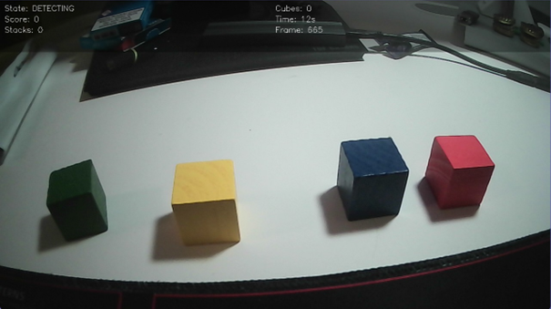
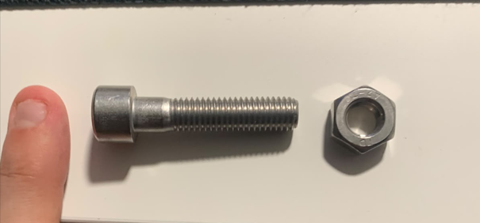
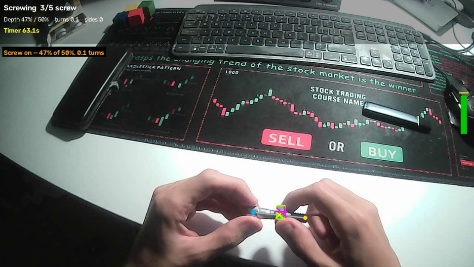

# Assessment Vision

Assessment Vision runs hand-skill games in front of a webcam and records what happens: how long each step takes and how the hands move. It has two kinds of games:

- **Cube stacking.** It detects colored cubes and tracks them across frames, then checks whether the stack is built correctly, either as one stack or in a random order.
- **Screwing.** You pick up a screw and a nut, screw the nut on to a depth set by the difficulty, unscrew it, and put both parts back on the table. A small learned detector finds the screw and nut, and MediaPipe tracks the hands.

The inference flow keeps video datasets, model backends and stateful tasks separate, so other computer-vision models can be added without tying the app to one model library. See the [project documentation index](docs/index.md) for architecture, perception, models, datasets, evaluation, analysis, application interfaces and device support.

| Cube stacking | Screwing parts | Screwing game (hand tracking and detector) |
|---|---|---|
|  |  |  |

[Play the sample cube-detection video](docs/assets/demo.mp4)

## Quick start (Windows, webcam)

You need Python 3.10 or newer and [uv](https://docs.astral.sh/uv/).

```powershell
git clone git@github.com:wagnerp4/assessment_vision.git
cd assessment_vision
uv sync --extra pose --extra detector --extra analysis

# Hand-tracking model (downloaded once, not part of the repository)
mkdir models
curl -L "https://storage.googleapis.com/mediapipe-models/hand_landmarker/hand_landmarker/float16/1/hand_landmarker.task" -o models/hand_landmarker.task

uv run python -m assessment_app --pose
```

The camera opens on a menu over the live view:

1. Choose a game (simple stacking, random stacking, or **screwing**), a difficulty, and the hand options. Click the options or use the arrow keys.
2. Start with **Start game**, `s` or Enter.
3. When the game ends, a summary is shown. Press any key to return to the menu, and press `q` in the menu to quit.

**Keys during a game:**

| Key | Action |
|---|---|
| `s` | restart |
| `r` | reset |
| `p` | pause or resume |
| `v` | start or stop recording the annotated view to `runs/` |
| `g` | toggle the finger-pair rule (hand tracking on) |
| `f` | cycle the required finger pair (hand tracking on) |
| `q` | end the game: the summary is shown when there is progress, then the menu returns |

Every game is saved to `runs/` as a JSON event log, with a summary figure.

**Options:**
- Flags such as `--game`, `--difficulty`, `--pose`, `--finger-rule` and `--record` set the menu's starting choices.
- `--camera-id 1` picks another camera.
- `--playing-hand left` is for left-handed players.

### The screwing game

| Step | What to do | Moves on when |
|---|---|---|
| 1 Setup | Lay the screw and the nut apart on the table, with your hands in view | both parts and a hand are seen, the nut is off the screw |
| 2 Pick up | Screw in the left hand, nut in the right | both parts are lifted off their resting places and held for 1 s |
| 3 Screw | Turn the nut on to the target | the nut reaches the target with a fingertip on it |
| 4 Unscrew | Hold the screw and turn the nut off | the nut is seen clear of the screw for 1 s |
| 5 Put down | Put both parts on the table and take your hands away | both parts lie apart with no hand on them |

- **Depth is the share of the thread:** 0 % with the nut on the tip, 100 % at the end of the thread.
- **Targets:** easy 25 %, medium 40 %, hard 50 %, expert 75 %.
- **Spins:** a nut that moves along the thread with no fingertip on it counts as spun. The game shows a warning and counts the spin in the summary.

The screwing game needs hand tracking, so the menu turns it on.

**The screw and nut detector:**
- The app uses the learned detector `models/fastener_detector.onnx` when that file is present. Without it, the app falls back to a classical detector, which only works with the parts lying on a plain white surface.
- The trained weights are not in the repository. Train them on your own screw and nut with the tools described in [docs/models/fastener-detector.md](docs/models/fastener-detector.md), which cover recording, labeling, training on a GPU, export, and benchmarks.

## Video mode

```bash
uv run python -m assessment_app --mode video --video docs/assets/demo.mp4 --difficulty easy --pose
```

- `--output assessment_output.mp4` saves the annotated video.
- `--game screwing` runs the screwing game on a recording.
- The hand model defaults to `models/hand_landmarker.task`, and `--pose-model` points elsewhere. For the older body-based model, use `--pose-backend holistic` with `models/holistic_landmarker.task`.
- Inference runs on the CPU.
- The overlay shows landmark estimates; it does not measure grip force.

### Camera access from WSL

Linux applications inside WSL cannot automatically access a Windows webcam. For WSL 2, install Microsoft's `usbipd-win` and keep a WSL terminal open. In an elevated PowerShell, list USB devices and share the webcam:

```powershell
usbipd list
usbipd bind --busid <busid>
```

Then, in a regular PowerShell, attach it to WSL (replace `<busid>` with the listed bus ID):

```powershell
usbipd attach --wsl --busid <busid>
```

Back in WSL, verify that Linux exposes a video device, then run the camera mode:

```bash
ls -l /dev/video*
uv run python -m assessment_app --mode camera --camera-id 0 --difficulty easy
```

The USB device is unavailable to Windows while attached to WSL. Detach it from PowerShell with `usbipd detach --busid <busid>` when finished. Some built-in cameras are not exposed as attachable USB devices; in that case use a USB webcam or run the app on Windows. See [Microsoft's WSL USB device guide](https://learn.microsoft.com/en-us/windows/wsl/connect-usb) for prerequisites and details. If the app cannot open the camera and WSL has no `/dev/video*` device, the app prints this setup hint; it cannot enable hardware passthrough itself.

### Browser version (web server)

`assessment_app.web` serves a page that asks for camera access, streams webcam frames over a WebSocket, and shows the annotated stacking game. Each browser connection gets its own pipeline. Pose detection is disabled in the web version.

```bash
uv sync --extra web
uv run assessment-web   # http://localhost:8080 (set PORT to change)
```

Browsers only allow camera access over HTTPS or on `localhost`. To deploy on [Fly.io](https://fly.io) (the image builds remotely, so Docker is not required locally):

```bash
fly auth login
fly launch --no-deploy --copy-config   # choose a unique app name; keeps fly.toml settings
fly deploy
fly open
```

Machines stop when idle and start on the next request, so the first load after a pause takes a few seconds. Cube colors are calibrated for specific cubes and lighting, and browsers do not allow the locked exposure used in camera mode, so detection quality depends on the room.


## Integration contracts

- `Dataset` streams `DatasetSample` records and timestamped `Frame` objects. `VideoDataset` reads one video or a JSONL manifest. Manifest paths are relative to the manifest file; each non-comment line contains `sample_id`, `video`, and optional `annotations` and `metadata` fields.
- `ModelBackend` loads an implementation and returns normalized observations. The built-in `HSVCubeBackend` adapts the OpenCV detector. The core package has no PyTorch or Transformers dependency; future adapters can implement the same contract.
- `VisionTask` consumes ordered frame observations and maintains state for a sequence. `CubeStackingTask` adapts the current stacking and game logic.
- Shared observation types include cube detections, person and hand pose landmarks, scene-graph nodes and relations, and timed action events. Person identity is local to a sequence unless a future task explicitly defines otherwise.

For example, one JSONL entry can pair a video with a future annotation sidecar:

```json
{"sample_id":"session-001","video":"videos/session-001.mp4","annotations":"annotations/session-001.json","metadata":{"fps":30}}
```

The first person-focused extension is human and hand pose estimation. A later interaction task can combine hand landmarks with cube tracks to record observable reach, pickup, placement, and stacking intervals. Video timing and finger positions alone do not measure grip force. The application reports observable events; it does not diagnose illness or make clinical assessments.

## Development

Install the development tools with `uv sync --extra dev` and run the tests with `uv run pytest`. Training the screw and nut detector needs `uv sync --extra train`, which installs CUDA PyTorch from the PyTorch cu130 index; it also runs on the CPU. The sample video is useful for a visual smoke test, but labeled and consented recordings are needed to evaluate pose, hand-contact, and behavioral-analysis performance.
